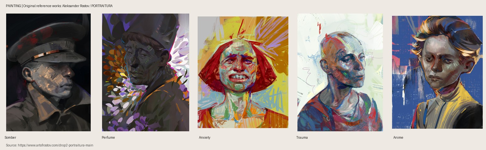
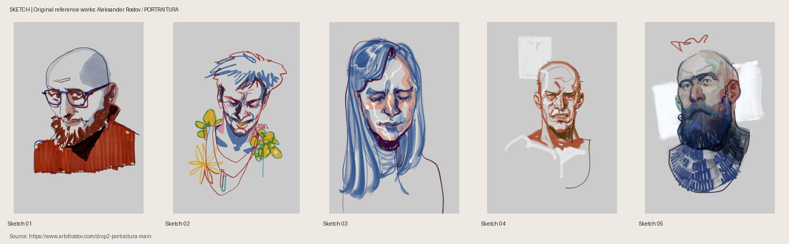

# PORTRAITURA 肖像工作室

先选择 **绘画肖像** 或 **肖像速写**，再提供 **本人照片＋一句自我描述**，生成既能认出本人、又能表现内在状态的个人肖像。

这是独立的 AI Agent Skill，视觉参考限定于 Aleksander Rostov（[@artofrostov](https://x.com/artofrostov)）的 [PORTRAITURA 系列](https://www.artofrostov.com/drop2-portraitura-main)，并非作者官方产品或合作项目。

## 两种风格

### 绘画肖像

用色块、明暗、笔触和边缘变化塑造人物。内置 Somber、Perfume、Anxiety、Trauma、Anime 五幅参考。



### 肖像速写

用线条、留白与有限色彩捕捉神态。内置 Sketches of Faces 中的五幅参考；编号为本地索引，不是作者正式作品名。



以上展示的是作者参考原作，不是本 Skill 的生成效果。两组参考独立使用，不自动混合。

## 使用方法

在支持 Skill 与多图参考生图的 Agent 中，上传照片并输入：

```text
使用 $portraitura-portrait-studio。
风格：绘画肖像。
自我描述：外表平静，内心充满好奇。
请根据我上传的照片创作一幅肖像。
```

也可以选择“肖像速写”。如果没有选风格，Agent 会先展示两个风格的参考预览，只询问缺失的输入。

预期交付：一幅肖像、一句创作说明、实际使用的原作来源链接，以及记录参考与观察结果的 `portrait-notes.md`。

支持自然语言修改，例如“更像我一点”“状态更明显”“更接近参考画法”。Skill 分别处理身份特征、情绪表达与画法，避免每次都全面重画。

## 安装到 Codex

前置条件：能够读取 Skill 的 Agent，以及能接收身份照片和画风参考的图像生成/编辑工具。Codex 默认使用内置 image_gen。Git 仅用于下方克隆流程，也可使用 GitHub 的 Download ZIP 解压安装。

本 Skill 不包含图像模型。生图工具的可用性和费用取决于宿主环境。10 张参考原图已随仓库提供，无须 TikHub、下载脚本或额外爬虫密钥。

### Windows / PowerShell

```powershell
$skillHome = if ($env:CODEX_HOME) { $env:CODEX_HOME } else { Join-Path $HOME '.codex' }
$skillsDirectory = Join-Path $skillHome 'skills'
New-Item -ItemType Directory -Force -Path $skillsDirectory | Out-Null
$skillDirectory = Join-Path $skillsDirectory 'portraitura-portrait-studio'
git clone https://github.com/xuntianx/portraitura-portrait-studio.git "$skillDirectory"
```

### macOS / Linux / Git Bash

```bash
skill_home="${CODEX_HOME:-$HOME/.codex}"
mkdir -p "$skill_home/skills"
git clone https://github.com/xuntianx/portraitura-portrait-studio.git "$skill_home/skills/portraitura-portrait-studio"
```

目标目录已存在时，先确认是否有本地修改，更新现有目录，不直接覆盖。若 Skill 没有立即显示，可新开聊天或重新加载宿主的 Skill 列表。

## 参考图与来源标注

- `assets/painting/`：5 幅绘画肖像原图。
- `assets/sketch/`：5 幅肖像素描原图。
- `assets/previews/`：2 张风格选择预览。
- [source-manifest.json](references/source-manifest.json)：逐图来源页面、原图 URL、年份说明、采集时间、尺寸与 SHA-256。

每幅生成肖像默认包含：

```text
AI-generated portrait
Visual inspiration: @artofrostov / PORTRAITURA
```

标注说明 AI 生成与视觉参考，不表示作者亲绘、授权或认可。原作及预览中的原作部分归原作者所有，本仓库不授予这些图片的额外使用权。详见 [ATTRIBUTION.md](ATTRIBUTION.md)。

## 文件导航

| 文件 | 用途 |
|---|---|
| [SKILL.md](SKILL.md) | 输入流程、参考选择、生成、修改与验收规则 |
| [painting.md](references/painting.md) | 绘画肖像的结构、边缘、笔触与参考分工 |
| [sketch.md](references/sketch.md) | 肖像速写的线条、色块与留白规则 |
| [openai.yaml](agents/openai.yaml) | Codex 展示名称与调用示例 |

## 验证状态

更新日期：2026-11-13。此版本已使用同一张用户照片和“压抑即将爆发”的自述完成绘画模式两轮实测。第二轮调整了身份与照片光影的边界、参考画法分工，以及神态、空间、绘画组织三个表达层面。

观察到第二版构图更紧、面部色块更概括、笔触疏密变化更明显；仍偏写实油画，参考原作的破碎抽象处理未完全体现。这是已知提示词的视觉自查，不是盲评或跨人物性能证明。速写模式尚未进行生图实测。

Skill 格式、UTF-8 文本、参考图哈希和资源路径已在 Windows 环境检查。macOS/Linux 安装入口按跨平台路径编写，尚未在对应系统实际执行。测试用户照片、生成肖像及其私人输入不包含在本仓库中。
